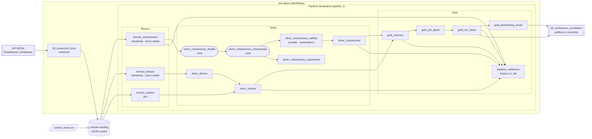
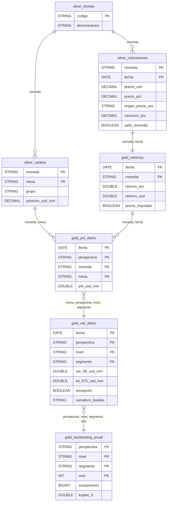

# TP final — Big Data y MLOps

| | |
|---|---|
| **Estudiante** | Martin Lin |
| **Variante** | 2 — Ejecución |
| **Opción** | A — Arquitectura medallion en Databricks |
| **Caso** | Riesgo de mercado (VaR) de una cartera hipotética en moneda extranjera, con cotizaciones oficiales del BCRA |
| **Pipeline** | `pipeline_fx` (Lakeflow Declarative Pipelines, serverless, Databricks Free Edition) |

## Objetivo

Construir sobre Databricks una plataforma de datos que, a partir de las cotizaciones oficiales publicadas por el Banco Central de la República Argentina (BCRA), calcule cada día el riesgo de mercado de una cartera en moneda extranjera y verifique si el modelo de riesgo funcionó en el tiempo.

El área usuaria es un departamento de riesgos de un banco **hipotético**. Necesita responder todos los días:

1. ¿Cuánto podría perder la cartera mañana con 99 % de confianza (VaR) y cuánto en promedio si se supera ese umbral (Expected Shortfall)?
2. ¿Qué mesa o grupo de monedas concentra el riesgo y cuánto aporta la diversificación?
3. ¿El modelo de VaR fue adecuado en el pasado (backtesting, test de Kupiec, semáforo de Basilea)?

Se calculan dos perspectivas con la misma lógica: **ARS**, el riesgo de la posición en moneda extranjera frente al peso, que es lo que mira el regulador local; y **USD**, el riesgo cruzado entre monedas, sin el peso.

> La cartera es inventada y no representa a ninguna entidad real. Los datos de mercado son públicos.

## Contenido de la carpeta

```
tp-final/
├── README.md                              este documento
├── databricks.yml                         bundle: pipeline + Job diario (extracción → pipeline)
├── extraccion/
│   └── 00_extraccion_bcra.py              notebook: API del BCRA → JSON crudos en el volume (1.ª tarea del Job)
├── pipeline/                              código fuente del pipeline (carpeta transformations en Databricks)
│   ├── 01_bronze.py                       Auto Loader sobre los JSON, maestro de divisas y cartera
│   ├── 02_silver.py                       aplanado, tipado, reglas de calidad, cuarentena, deduplicación
│   ├── 03_gold.py                         retornos, P&L, VaR / ES, backtesting
│   └── 04_validacion.py                   conciliación entre capas (expect_or_fail)
├── notebooks/
│   └── 05_verificacion_resultados.py      consultas, event log y gráficos de verificación
├── referencia/
│   └── cartera_base.csv                   cartera hipotética: 34 posiciones en 29 monedas y 4 mesas
├── tests/
│   └── prueba_local.py                    prueba de la lógica con PySpark local y problemas sembrados
├── diagramas/                             arquitectura.png y modelo_datos.png (los mismos diagramas de este README)
└── evidencia/                             capturas de ejecución
```

## 1. Datos

### Origen

**API pública de Estadísticas Cambiarias v1.0 del BCRA** (`https://api.bcra.gob.ar/estadisticascambiarias/v1.0`), sin autenticación.

| Endpoint | Uso |
|---|---|
| `GET /Cotizaciones/{moneda}?fechadesde&fechahasta` | serie diaria de una moneda; hasta 1.000 fechas por llamada |
| `GET /Maestros/Divisas` | códigos y nombres de las divisas |

Además se usa un CSV de referencia con la cartera hipotética (`referencia/cartera_base.csv`): una fila por posición, con moneda, grupo, mesa y posición en millones de USD equivalentes.

### Esquema de entrada

Respuesta de `/Cotizaciones/{moneda}`, guardada sin modificar dentro de cada archivo de landing:

```json
{ "status": 200,
  "metadata": { "resultset": { "count": 241, "offset": 0, "limit": 1000 } },
  "results": [ { "fecha": "2025-12-31",
                 "detalle": [ { "codigoMoneda": "EUR", "descripcion": "EURO",
                                "tipoPase": 1.1227, "tipoCotizacion": 1704.2586 } ] } ] }
```

| Campo | Significado (verificado contra la API) |
|---|---|
| `tipoPase` | dólares por unidad de la moneda. Para USD y REF viene en 0. |
| `tipoCotizacion` | pesos por unidad de la moneda (= `tipoPase` × cotización del USD). Para oro (XAU) y plata (XAG) viene en 0 y hay que derivarlo. |

### Volumen extraído

| Métrica | Valor |
|---|---|
| Monedas | 30: las 29 de la cartera y REF (dólar de la Comunicación A 3500, usado como control) |
| Período | 01/01/2003 a la fecha |
| Llamadas a la API (moneda × año) | 720, 76 de ellas vacías porque la moneda todavía no se publicaba |
| Cotizaciones (moneda × fecha) | 156.799 |
| Tiempo de la carga histórica | 3,1 minutos |

### Criterio de elección

- Son datos reales, públicos y oficiales, con más de 20 años de historia diaria.
- Tienen llegada incremental natural (un dato nuevo por día hábil) y problemas de calidad reales (sección 4.2).
- El caso es representativo del trabajo de un área de riesgos bancaria y obliga a modelar series temporales, calendarios distintos por moneda, revisiones de datos y agregaciones de riesgo.

## 2. Arquitectura



| Componente | Tecnología | Por qué |
|---|---|---|
| Extracción | Notebook Python (`requests`, reintentos, descarga en paralelo) | La API es HTTP; el notebook corre en el mismo entorno y se orquesta como tarea del Job. |
| Landing | Volume de Unity Catalog, JSON crudo por moneda × año × corrida | Conserva la respuesta original (trazabilidad) y desacopla la extracción del procesamiento. |
| Ingesta | Auto Loader (`cloudFiles`) en streaming tables | Procesa cada archivo una sola vez: la ingesta es incremental e idempotente. |
| Transformación | Lakeflow Declarative Pipelines, Python (`pyspark.pipelines`), serverless | Lo pide la consigna; el orden sale de las dependencias y la calidad queda registrada. |
| Calidad | Expectations (`expect`, `expect_all_or_drop`, `expect_all_or_fail`) + cuarentena | Métricas por regla en el event log; las filas rechazadas quedan con su motivo. |
| Almacenamiento | Delta Lake en `workspace.martin_lin_tp_fx` | Formato transaccional, con historial de versiones. |
| Orquestación | Job con dos tareas: extracción → pipeline | La extracción no es una transformación, pero tiene que correr antes. |
| Consumo | Notebook con SQL y matplotlib | Verificación y visualización de resultados. |

### Orden de ejecución del pipeline

El orden **no se programa: se declara**. Al iniciar una actualización, Databricks lee los cuatro archivos, registra cada tabla y detecta de qué tablas lee cada una (`spark.read.table("…")`). Con eso arma el grafo de dependencias y ejecuta cada tabla cuando terminaron las que necesita; las independientes corren en paralelo. Los prefijos `01_` a `04_` de los archivos son sólo para lectura humana.

Orden resultante:

1. `bronze_cotizaciones`, `bronze_divisas` y `bronze_cartera`, en paralelo.
2. `silver_divisas` → `silver_cartera`; en paralelo, `silver_cotizaciones_detalle` → `silver_cotizaciones_chequeadas`.
3. `silver_cotizaciones_validas` → `silver_cotizaciones`; en paralelo, `silver_cotizaciones_cuarentena`.
4. `gold_retornos` → `gold_pnl_diario` → `gold_var_diario` → `gold_backtesting_anual`.
5. `pipeline_validacion`, que lee de todas las capas.

## 3. Modelado de las tablas



| Tabla | Capa | Tipo | Grano (una fila por…) | Filas | Responde |
|---|---|---|---|---|---|
| `bronze_cotizaciones` | Bronze | streaming table | archivo (moneda × año × corrida) | 750 (720 de la carga histórica + 30 de una corrida incremental) | qué devolvió la API y cuándo |
| `bronze_divisas` | Bronze | streaming table | corrida de extracción | 1 | maestro de divisas |
| `bronze_cartera` | Bronze | materialized view | fila del CSV | 34 | — |
| `silver_divisas` | Silver | materialized view | código de divisa | 43 | dimensión moneda |
| `silver_cartera` | Silver | materialized view | moneda × mesa | 34 | posiciones válidas |
| `silver_cotizaciones` | Silver | materialized view | moneda × fecha | 155.487 | precio limpio en USD y en pesos |
| `silver_cotizaciones_cuarentena` | Silver | materialized view | fila rechazada | 509 | qué se descartó y por qué |
| `gold_retornos` | Gold | materialized view | fecha × moneda de la cartera | ~170 mil | retornos sobre un calendario común |
| `gold_pnl_diario` | Gold | materialized view | fecha × perspectiva × posición | ~398 mil | resultado diario por posición |
| `gold_var_diario` | Gold | materialized view | fecha × perspectiva × nivel × segmento | ~129 mil | riesgo diario de la cartera, cada mesa y cada grupo |
| `gold_backtesting_anual` | Gold | materialized view | perspectiva × nivel × segmento × año | 506 | ¿el modelo funcionó? |
| `pipeline_validacion` | Gold | materialized view | actualización | 1 | ¿concilian las capas? |

## 4. Reglas de transformación y decisiones técnicas

### 4.1 Extracción (`00_extraccion_bcra.py`)

- Una llamada por moneda y año calendario, en paralelo (4 hilos) y con reintentos ante errores transitorios. La API, detrás de Cloudflare, devuelve 502 intermitentes: se reintenta hasta 6 veces con espera exponencial (2 a 64 s).
- **Incremental:** un año cerrado y descargado completo no se vuelve a pedir. El año en curso se relee entero en cada corrida, para capturar publicaciones tardías y revisiones.
- **Append-only:** el nombre de cada archivo incluye el id de la corrida, así que nunca se sobrescribe un archivo.
- **Fallas visibles:** un chequeo previo frena la corrida si la API no responde o hay un error de certificado. Los tramos fallidos se listan y la tarea termina en error; la corrida siguiente pide sólo lo que falta. Hay además un tiempo máximo configurable.

### 4.2 Silver: reglas de calidad

Las reglas están en un único diccionario (`QUALITY_RULES`), que alimenta tanto las expectations como el motivo de la cuarentena, así que las dos cosas no pueden divergir. Cada regla se evalúa con `coalesce(…, false)`: una regla que da NULL cuenta como incumplida.

| Regla | Condición | Rechazos en la ejecución |
|---|---|---|
| `fecha_valida` | la fecha se puede convertir | 0 |
| `moneda_coincide_con_pedido` | `codigoMoneda` = moneda pedida | 0 |
| `fecha_dentro_del_tramo` | fecha entre `fechadesde` y `fechahasta` | 0 |
| `dia_habil` | no es sábado ni domingo | **72**: el sábado 16/06/2012 aparece tres veces por moneda en 24 monedas |
| `valores_numericos` | pase y cotización numéricos | 0 |
| `copias_de_la_fecha_coinciden` | las copias repetidas de una moneda y fecha traen los mismos valores | **435** en 7 fechas (ver *Deduplicación*) |
| `precio_ars_calculable` | precio en pesos > 0 (directo o derivado) | **2**: el BCRA publicó el oro con pase y cotización en 0 el 14/02/2003 y el 19/01/2004 |
| `cotizacion_consistente_con_pase` *(sólo aviso)* | \|cotización − pase × USD\| / cotización ≤ 1 % | **27 avisos**, entre ellos XDR en 2013 con 72,7 % de desvío |
| `dolar_consistente_con_ref` *(sólo aviso)* | \|USD / REF − 1\| ≤ 3 % | **11 avisos** (ver abajo) |

La tolerancia de consistencia empezó en 0,5 % y generaba 124 avisos. 87 eran del guaraní (PYG) en 2019–2020, con desvíos de 0,6–0,7 %, causados por redondeo: el BCRA publica el pase con 6 decimales y 0,000155 USD tiene un error relativo de ese orden. Se subió a 1 % para que los avisos señalen inconsistencias reales.

**Serie USD contra REF.** La API publica dos series del dólar: `USD`, un valor puntual del día, y `REF`, el tipo de cambio de referencia de la Comunicación A 3500 (promedio de las operaciones del día). Hay 11 días en que se apartan más de 3 %:

| Fecha | USD | REF | Variación de REF ese día | Desvío USD/REF | Lectura |
|---|---|---|---|---|---|
| 22/01/2014 | 7,14 | 6,912 | +0,5 % | +3,3 % | inicio de la devaluación de 2014 |
| 03/05/2018 | 23,00 | 21,749 | +3,7 % | +5,8 % | corrida cambiaria |
| 15/05/2018 | 24,05 | 24,800 | +0,1 % | −3,0 % | corrida cambiaria |
| 29/08/2018 | 34,00 | 31,942 | +1,9 % | +6,4 % | crisis de agosto |
| 30/08/2018 | 37,60 | 39,608 | +24,0 % | −5,1 % | crisis de agosto |
| 07/03/2019 | 42,50 | 41,225 | +1,8 % | +3,1 % | — |
| 12/08/2019 | 53,00 | 55,750 | +22,8 % | −4,9 % | PASO 2019 |
| **07/12/2023** | **385,00** | **364,408** | **+0,2 %** | **+5,7 %** | **error de publicación** |
| 16/04/2025 | 1.135 | 1.172,8 | −2,3 % | −3,2 % | inicio del régimen de bandas |
| 23/04/2025 | 1.160 | 1.122,5 | +2,7 % | +3,3 % | inicio del régimen de bandas |
| 27/10/2025 | 1.435 | 1.378,9 | −7,2 % | +4,1 % | día posterior a las elecciones |

En diez de los once días el desvío se explica por la volatilidad del día, porque un valor puntual y un promedio se separan cuando el mercado se mueve mucho. El 07/12/2023 es distinto: REF casi no se movió, el USD saltó 5,7 % y volvió al día siguiente (365,95). Además, el BCRA calculó con ese valor la cotización en pesos de todas las monedas, así que la cartera mostraba una ganancia ficticia el 07/12 y una excepción de −4,26 el 11/12.

Una primera versión mandaba a cuarentena todos los días con desvío mayor a 3 %. Se descartó: borraba los diez días de crisis, que son justamente los movimientos más grandes de la historia, y el VaR habría quedado artificialmente bajo.

**Valuación en pesos con REF.** La solución adoptada es valuar en pesos con REF, el tipo de cambio de referencia que usa la normativa del BCRA. Como el BCRA calcula `tipoCotizacion` con su serie USD, se reescala:

- monedas con cotización: `precio_ars = tipoCotizacion × REF / USD` (para el USD da exactamente REF);
- oro y plata, que traen la cotización en 0: `precio_ars = tipoPase × REF`;
- si un día falta REF, se usa la serie USD.

La columna `origen_precio_ars` registra qué fórmula se aplicó. Así el error del 07/12/2023 se corrige solo, sin descartar ningún día, y el control queda como aviso. La perspectiva USD no se ve afectada, porque usa el pase.

**Deduplicación.** Una misma moneda y fecha llega repetida por dos motivos:

- **Entre corridas:** el año en curso se relee en cada extracción.
- **Dentro de una misma respuesta de la API:** el BCRA repite fechas en al menos 94 días entre 2006 y 2017, la mayoría en los primeros días hábiles de enero. El caso extremo es el 09/11/2012, que aparece 13 veces en 23 monedas; el 06/09/2017 aparece 5 veces.

Cuando las copias de una misma corrida traen **valores distintos**, no hay forma de saber cuál es la correcta. Por ejemplo, el 06/09/2017 viene 5 veces y una de las copias duplica el valor. Esas filas van a cuarentena (`copias_de_la_fecha_coinciden`) y Gold usa el precio del día anterior. Una versión intermedia elegía la copia de mayor valor, y el backtesting lo delató: aparecieron un resultado de +88 el 06/09/2017 y otro de −41 el 07/09/2017.

Fechas con copias contradictorias:

| Fecha | Filas en cuarentena | Monedas | Copias por moneda |
|---|---|---|---|
| 06/09/2017 | 150 | 30 | 5 |
| 22/11/2016 | 87 | 29 | 3 |
| 02/03/2007 | 66 | 22 | 3 |
| 26/05/2006 | 66 | 22 | 3 |
| 17/10/2008 | 46 | 23 | 2 |
| 02/09/2013 | 14 | 5 | 3 (en 4 monedas) |
| 23/05/2011 | 6 | 3 | 2 |

Cuando las copias coinciden, se conserva una sola: es el caso de las 13 copias del 09/11/2012 y de las repeticiones de los primeros días hábiles de enero. Entre corridas gana la versión descargada más recientemente (`extracted_at`). Una versión inválida nunca reemplaza a una válida, porque la competencia ocurre sólo entre filas válidas. Resultado: 155.487 cotizaciones únicas.

**Saltos.** Las variaciones diarias mayores al 10 % se marcan (`salto_anomalo`) pero no se descartan: una devaluación es un dato real, no un error.

**Maestro de divisas.** Trae el código NIO dos veces; se conserva uno por código (44 → 43).

### 4.3 Gold: metodología de riesgo

| Elemento | Definición |
|---|---|
| Calendario | Fechas con cotización del USD. Si una moneda no tiene precio un día, se repite el último (`precio_imputado`). Antes de que el BCRA publique una moneda, su retorno es nulo y aporta 0. |
| Retorno | Simple: P(t) / P(t−1) − 1, en pesos (ARS) y en dólares (USD). |
| Resultado diario (P&L) | Posición (millones de USD eq.) × retorno. Cartera estática: P&L hipotético, el estándar para backtesting. |
| VaR 99 % | Simulación histórica: 3.ª peor pérdida de los 250 días hábiles **anteriores** (sin incluir el día evaluado). |
| VaR 97,5 % / ES 97,5 % | 7.ª peor pérdida / promedio de las 7 peores (⌈250 × 2,5 %⌉ = 7). |
| Excepción | El resultado del día es menor que −VaR 99 % del mismo día. |
| Semáforo de Basilea | Excepciones en los últimos 250 días: verde 0–4, amarillo 5–9, rojo 10 o más. |
| Test de Kupiec | Cobertura incondicional, LR ~ χ²(1); se rechaza el modelo si LR > 3,841 (95 %). Es de dos colas: rechaza tanto por exceso como por falta de excepciones. |
| Niveles | Cartera total, cada una de las 4 mesas y cada uno de los 6 grupos de monedas. |

### 4.4 Validación (`04_validacion.py`)

Ocho controles `expect_or_fail`. Si alguno falla, la actualización termina en error y no se publican resultados inconsistentes.

| Control | Qué verifica |
|---|---|
| `bronze_tiene_archivos` | llegaron archivos |
| `silver_sin_duplicados` | una fila por moneda y fecha |
| `cartera_con_cotizaciones` | todas las monedas de la cartera tienen precio |
| `retornos_grilla_completa` | filas de retornos = fechas × monedas |
| `pnl_cartera_igual_suma_mesas` / `…_grupos` | el resultado total es igual a la suma por mesa y por grupo |
| `var_calculado_en_ambas_perspectivas` | hay VaR en ARS y en USD |
| `es_mayor_o_igual_que_var_mismo_nivel` | ES 97,5 % ≥ VaR 97,5 % (propiedad matemática) |

En la prueba local, este último control detectó un error de diseño: originalmente comparaba ES 97,5 % contra VaR 99 %, una relación que **no** está garantizada (por ejemplo, con tres pérdidas grandes y cuatro chicas). Se corrigió para comparar al mismo nivel de confianza.

### 4.5 Decisiones y alternativas

| Decisión | Alternativa descartada | Motivo |
|---|---|---|
| Landing con JSON crudo + Auto Loader | Escribir directo a una tabla desde la extracción | Separa la descarga del procesamiento, conserva el original y hace idempotente la ingesta. |
| Una llamada por moneda × año | Una llamada por día (todas las monedas) | 720 llamadas en lugar de ~6.000; la carga histórica tarda 3 minutos. |
| Releer el año en curso en cada corrida | Pedir sólo días nuevos | Pidiendo sólo días nuevos, si ayer no estaba publicado al momento de la extracción quedaría un hueco permanente. |
| Bronze sin tipar (todo texto) | Tipar en la lectura | Un valor raro no rompe la ingesta; el tipado y su control quedan en Silver. |
| Una sola fuente de reglas | Reglas separadas para expectations y cuarentena | Métricas y motivos no pueden contradecirse. |
| Valuar en pesos con REF (A3500) | Usar `tipoCotizacion` tal cual (serie USD) o descartar los días en que USD y REF difieren | REF es la referencia normativa y es un promedio del día, más estable; corrige el error del 07/12/2023 sin borrar días de crisis. |
| Silver y Gold como materialized views | `AUTO CDC` / `MERGE` incremental | Con 157 mil cotizaciones el recálculo completo cuesta segundos y da resultados deterministas. |
| Cartera estática (P&L hipotético) | Posiciones que cambian cada día | Es lo que exige el backtesting regulatorio: aísla la calidad del modelo de los cambios de cartera. |
| Simulación histórica | VaR paramétrico (varianza-covarianza) | No supone normalidad; los retornos del peso tienen colas muy pesadas (devaluaciones). |
| Dos perspectivas (ARS y USD) | Una sola | Mismo costo; muestran riesgos distintos, y su comparación es parte del resultado. |
| `try_divide` y `try_cast` | División y casteo directos | El cómputo serverless usa modo ANSI: una división por cero o un casteo inválido rompen la consulta. |

## 5. Resultados

### 5.1 Ejecución

- Actualización completa sin errores: 15 tablas y vistas, 8/8 controles de validación cumplidos.
- Calidad: 156.799 cotizaciones extraídas en la carga histórica. Quedan 509 en cuarentena: 435 por copias contradictorias en 7 fechas, 72 del sábado 16/06/2012 y 2 del oro en 0. Las copias idénticas se eliminan por deduplicación, y quedan 155.487 cotizaciones únicas. Además hay 38 avisos: 27 de consistencia pase/cotización y 11 de USD contra REF.
- Extracción incremental: una segunda corrida bajó sólo el año en curso (30 tramos, 5.940 cotizaciones, 6 segundos). El pipeline procesó sólo esos 30 archivos nuevos y Silver no agregó filas, porque esas fechas ya estaban.
- Al reejecutar el pipeline sin archivos nuevos, `bronze_cotizaciones` no escribe filas: la ingesta es idempotente.
- Prueba local (`tests/prueba_local.py`): siete problemas sembrados (sábado, fecha fuera de tramo, moneda equivocada, valor faltante, oro sin USD, cotización inconsistente y un día con el dólar mal publicado) detectados o corregidos; VaR y ES recalculados con Python puro coinciden con los del pipeline.

### 5.2 Riesgo actual (23/10/2026)

| Perspectiva | VaR 99 % cartera | ES 97,5 % | Suma VaR mesas | Diversificación | Excepciones 250 d | Semáforo |
|---|---|---|---|---|---|---|
| ARS | 1,38 | 2,50 | 1,70 | 19 % | 2 | verde |
| USD | 0,30 | 0,32 | 0,43 | 30 % | 6 | amarillo |

*Millones de USD equivalentes, horizonte 1 día.*

| Mesa | VaR 99 % ARS | VaR 99 % USD |
|---|---|---|
| Tesorería | 1,07 | 0,10 |
| Banca Corporativa | 0,31 | 0,02 |
| Inversiones (oro y plata) | 0,22 | 0,20 |
| Comercio Exterior | 0,11 | 0,11 |

- **En pesos**, Tesorería concentra el riesgo, porque tiene la mayor posición larga en dólares.
- **En pesos, el ES 97,5 % (2,50) es 82 % mayor que el VaR 99 % (1,38).** La ventana de 250 días incluye dos pérdidas extremas: el 13/10/2025 (−5,84) y el 27/10/2025 (−5,98), el día posterior a las elecciones, cuando REF cayó 7,2 %. El VaR es la 3.ª peor pérdida, así que queda por debajo de las dos y no las refleja; el ES, que promedia las 7 peores, sí. Es el argumento por el cual Basilea (FRTB) reemplazó el VaR por el ES para medir colas.
- **En dólares**, el riesgo lo dominan los metales: la mesa Inversiones tiene VaR 0,20 y 5 excepciones en los últimos 250 días (amarillo). Las monedas se compensan más entre sí, por eso la diversificación sube a 30 %.

### 5.3 Backtesting 2004–2026

| Perspectiva | Días | Excepciones | Esperadas (1 %) | Tasa | Kupiec global (LR) | Años con rechazo de Kupiec |
|---|---|---|---|---|---|---|
| ARS | 5.591 | 67 | 56 | 1,20 % | 2,09 → **no rechaza** | 7 de 23 (4 por **cero** excepciones) |
| USD | 5.591 | 88 | 56 | 1,57 % | 15,84 → rechaza | 8 de 23 (3 por cero excepciones) |

Años destacados, perspectiva ARS:

| Año | Excepciones | Zona | Kupiec | Lectura |
|---|---|---|---|---|
| 2008 | 9 | amarilla | rechaza | crisis financiera global |
| 2011 | 5 | amarilla | — | — |
| 2015 | 5 | amarilla | — | devaluación del yuan (agosto) y salida del cepo (17/12/2015) |
| 2018 | 7 | amarilla | rechaza | crisis cambiaria argentina |
| 2022 | 5 | amarilla | — | — |
| **2025** | **10** | **roja** | rechaza | salida del cepo y régimen de bandas (14/04/2025) |
| 2006, 2012, 2020 | 0 | verde | rechaza | exceso de conservadurismo |

**Efecto de valuar con REF.** Con la valuación original (serie USD) la perspectiva ARS tenía 74 excepciones y Kupiec rechazaba el modelo en el agregado (LR 5,33). Valuando con REF quedan 67 y el modelo pasa (LR 2,09). La diferencia neta, 7 excepciones, viene de dos fuentes: el error del 07/12/2023 y el uso de un promedio diario en lugar de un valor puntual, que en los días de crisis es menos ruidoso. No es sólo una resta: algunas excepciones cambian de fecha (por ejemplo, del 22/09 al 23/09/2025, porque el promedio refleja el movimiento un día después).

**Las dos salidas del cepo.** El modelo falla igual en las dos, y es la debilidad típica de la simulación histórica ante un cambio de régimen. Mientras rige el cepo, el tipo de cambio oficial se mueve poco y en una sola dirección. Una cartera larga en moneda extranjera casi no pierde, así que la ventana de 250 días muestra un VaR cercano a cero. Cuando el peso empieza a flotar, cualquier apreciación supera ese VaR.

| Salida del cepo | Excepciones posteriores | Período | VaR antes de la primera excepción |
|---|---|---|---|
| 17/12/2015 | 6 | 18/12/2015 – 22/03/2016 | 0,21 |
| 14/04/2025 (régimen de bandas) | 5 | 16/04/2025 – 08/05/2025 | 0,18 |

En ambos casos la pérdida viene de la posición en USD. En 2025 se suma un *crawling peg* previo (2 % mensual desde diciembre de 2023, 1 % desde febrero de 2025), con el que la cartera ganaba casi todos los días. Después de la salida hubo otras tres excepciones grandes (23/09, 13/10 y 27/10/2025, esta última el día posterior a las elecciones), y el año cerró con 10 y zona roja. A medida que la ventana incorporó la nueva volatilidad, el modelo se recalibró: en 2026 no hubo excepciones.

**Riesgo cruzado.** Entre 2021 y 2024, con el dólar oficial administrado, las únicas excepciones vienen del yuan, el oro y el real, con pérdidas chicas (≈ 0,2) frente a un VaR también chico. En 2015, las dos primeras excepciones del año (11/08 y 26/08) vienen del yuan y coinciden con la devaluación del yuan de agosto de 2015.

**Devaluaciones.** Para esta cartera las devaluaciones son **ganancias** (es larga en moneda extranjera), así que no generan excepciones. El riesgo de pérdida es la apreciación del peso.

**Conclusión.** Valuado con REF, el modelo en pesos es adecuado en el agregado (1,20 % de excepciones, Kupiec no rechaza). Sin embargo, falla de forma concentrada en crisis y cambios de régimen, y en esos momentos el semáforo pasa a amarillo o rojo. En dólares subestima el riesgo (1,57 %), sobre todo por los metales. Mejoras posibles: ventana con estrés (*stressed VaR*), ponderación por volatilidad (*filtered historical simulation*) o ventana más corta en regímenes inestables.

## 6. Cómo reproducir

**Requisitos:** workspace de Databricks con Unity Catalog y cómputo serverless (alcanza con la Free Edition) y acceso a internet desde el cómputo hacia `api.bcra.gob.ar`.

1. **Esquema y volume.** El notebook de extracción crea `workspace.martin_lin_tp_fx` y el volume `landing` si no existen.
2. **Cartera.** Subir `referencia/cartera_base.csv` a `/Volumes/workspace/martin_lin_tp_fx/landing/referencia/`.
3. **Extracción.** Importar `extraccion/00_extraccion_bcra.py`, poner `verificar_ssl = false` (ver Limitaciones) y ejecutar todo. Al final imprime un resumen de la corrida.
4. **Pipeline.** Jobs & Pipelines → Create → ETL pipeline:
   - catálogo `workspace`, esquema `martin_lin_tp_fx`, cómputo serverless;
   - en la carpeta `transformations`, los cuatro archivos de `pipeline/`;
   - en *Configuration*, estas dos claves:

   | Clave | Valor |
   |---|---|
   | `tp.landing_path` | `/Volumes/workspace/martin_lin_tp_fx/landing/bcra` |
   | `tp.cartera_path` | `/Volumes/workspace/martin_lin_tp_fx/landing/referencia/cartera_base.csv` |

   Después, **Dry run** (valida el grafo) y **Run pipeline**.
5. **Job (opcional).** Jobs & Pipelines → Create → Job, con dos tareas: `extraccion_bcra` (notebook, parámetro `verificar_ssl=false`) y `pipeline_medallion` (tipo Pipeline, depende de la primera). Alternativa por CLI: `databricks bundle deploy` con `databricks.yml`.
6. **Verificación.** Importar `notebooks/05_verificacion_resultados.py` y ejecutarlo.

**Prueba local (opcional):** `pip install pyspark==4.0.1 pandas && python tests/prueba_local.py`. Corre la misma lógica sobre datos sintéticos con problemas sembrados, con un simulador mínimo del módulo de pipelines. No reemplaza la ejecución en Databricks.

## 7. Evidencia de ejecución

Todo está en `evidencia/`. El archivo más completo es **`verificacion_resultados.html`**: el notebook de verificación exportado después de la última corrida, con todas las tablas, gráficos y conclusiones. Se abre con cualquier navegador.

| Archivo | Qué muestra | Punto de la consigna |
|---|---|---|
| `01_extraccion_historica.png` | resumen de la carga histórica: 30 monedas, 720 tramos, 0 errores, 156.799 cotizaciones en 3,1 min | 1 (datos) |
| `01b_extraccion_incremental.png` | segunda extracción: sólo el año en curso (30 tramos, 5.940 cotizaciones, 0,1 min) | 1 · 3 |
| `02_pipeline_tablas.png` | pestaña *Tables* de la corrida final: 15 tablas en verde, cuarentena 509, 38 avisos | 3 (ejecución completa) |
| `03_pipeline_grafo.png` | grafo de dependencias del pipeline (orden de ejecución) | 3 (configuración y orden) |
| `04_data_quality.png` | métricas de cada expectation desde el event log (`copias_de_la_fecha_coinciden` 435, `dia_habil` 72, …) | 2 (calidad en Silver) |
| `05_cuarentena.png` | tabla de cuarentena por motivo y fecha: 7 fechas con copias contradictorias (435 filas), el sábado 16/06/2012 (72) y el oro en 0 (2) | 2 (calidad en Silver) |
| `05b_usd_vs_ref.png` | los 11 días con USD apartado más de 3 % de REF; el 07/12/2023 es el único con REF quieto | 2 · 4 |
| `05c_idempotencia.png` | filas escritas en Bronze por corrida: 720, 0, 0, 30, 0 | 3 |
| `05d_incremental_dedup.png` | corrida con los 30 archivos nuevos: Bronze escribe 30 y Silver no agrega filas (captura previa a la regla de copias contradictorias, por eso la cuarentena muestra 74) | 3 |
| `06a_validacion_metricas.png` | `pipeline_validacion`: métricas de conciliación (750 archivos en Bronze, 155.487 filas y claves únicas en Silver, 0 monedas sin precio, diferencias de P&L del orden de 1e-14) | 3 · 5 |
| `06b_validacion_controles.png` | `pipeline_validacion`: los 8 controles en `True` | 3 · 5 |
| `07a_var_por_mesa.png` | VaR 99 % por mesa al 23/10/2026 y beneficio de diversificación | 5 (resultado) |
| `07b_ars_2023_2026.png` | resultado diario contra VaR en pesos, del *crawling peg* a la salida del cepo | 5 |
| `07c_ars_historia_completa.png` | ídem 2004–2026 (67 excepciones en 5.591 días) | 5 |
| `07d_usd_historia_completa.png` | ídem en dólares (88 excepciones en 5.591 días) | 5 |
| `07e_backtesting.png` | excepciones por año con zonas de Basilea y rechazos de Kupiec | 5 |
| `verificacion_resultados.html` | notebook completo; incluye además el detalle de excepciones desde 2015 | 2 · 3 · 5 |

## 8. Limitaciones

- **Verificación SSL desactivada** en la extracción (`verificar_ssl = false`), igual que en el script de referencia `bcra_data.py`, porque la API no presentó una cadena de certificados verificable desde el cómputo. En producción se agregaría el certificado intermedio al bundle de confianza (el notebook acepta una ruta a un `.pem`).
- **Cartera estática e hipotética.** No representa a ninguna entidad. Las posiciones de monedas sin historia en los primeros años aportan 0, lo que subestima el riesgo en esos períodos.
- **Precio repetido en días sin dato.** Si una moneda no tiene precio un día, se repite el último, así que el movimiento de dos días aparece concentrado en uno.
- **Sólo riesgo cambiario lineal.** No hay opciones, tasas ni riesgo de liquidez; horizonte de 1 día sin escalar a 10 días.
- **Valuación con REF (promedio diario).** Es la referencia normativa y es menos ruidosa, pero en días de crisis refleja el movimiento con un día de retraso respecto de un valor de cierre.
- **Tipo de cambio oficial.** En períodos de cepo (2011–2015, 2019–2025) el oficial no refleja el precio al que el mercado operaba realmente (brecha con los dólares financieros).
- **Recálculo completo** en Silver y Gold. Es correcto a esta escala; con más volumen convendría `AUTO CDC` en Silver. Algunas tablas usan `current_timestamp()`, lo que impide el refresco incremental de las materialized views.
- **Dependencia de la API.** Los 502 intermitentes de Cloudflare se manejan con reintentos, pero un corte prolongado deja el día sin actualizar hasta la corrida siguiente.

## 9. Fuentes y referencias

- BCRA — [API Estadísticas Cambiarias v1.0 (manual)](https://www.bcra.gob.ar/archivos/Catalogo/Content/files/pdf/estadisticascambiarias-v1.pdf) y [catálogo de APIs](https://www.bcra.gob.ar/apis-banco-central/).
- Databricks — [Lakeflow Declarative Pipelines: expectations](https://docs.databricks.com/aws/en/ldp/expectations), [referencia Python `@table`](https://docs.databricks.com/gcp/en/ldp/developer/ldp-python-ref-table), [opciones de Auto Loader](https://docs.databricks.com/en/ingestion/auto-loader/options.html), [limitaciones de la Free Edition](https://docs.databricks.com/aws/en/getting-started/free-edition-limitations).
- Comité de Supervisión Bancaria de Basilea — *Supervisory framework for the use of "backtesting" in conjunction with the internal models approach to market risk capital requirements* (1996): zonas verde, amarilla y roja.
- Kupiec, P. (1995). *Techniques for verifying the accuracy of risk measurement models*. Journal of Derivatives, 3(2).
- Contexto cambiario: salida del cepo y régimen de bandas desde el 14/04/2025 ([Valora Analitik, 11/04/2025](https://www.valoraanalitik.com/?p=455825)).
- Script de extracción de referencia: `bcra_data.py` (propio), adaptado en `00_extraccion_bcra.py`.
